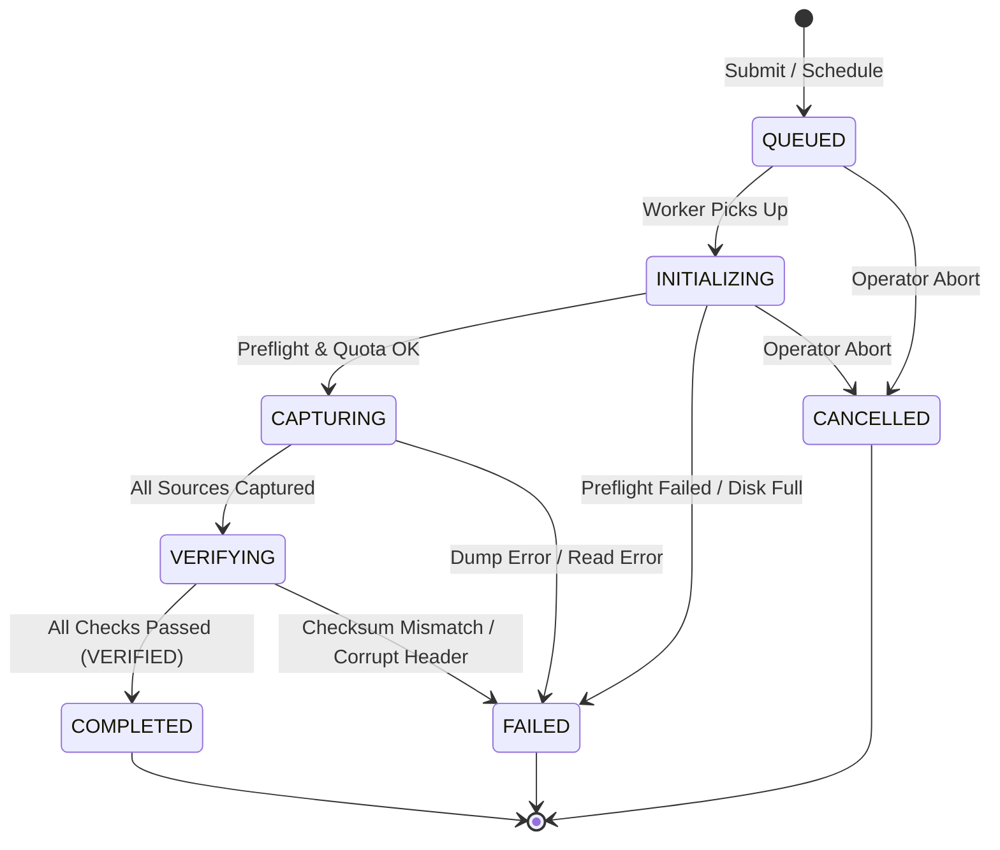

# Zima Control Center — Backup Foundation Technical Contract
**Document Type:** Technical Architecture & Specification Contract  
**Status:** Approved Architectural Design  
**Target Milestone:** 2C-16 (Backup Foundation Design)  
**Authoritative Reference:** `docs/ZCC-PRODUCT-ARCHITECTURE-AND-SCOPE.md`  
**Companion Document:** `docs/ZCC-BACKUP-FOUNDATION-PRD.md`  
**Current Baseline:** `959c5a8`

---

## 1. Architectural Principles & Design Decisions

### 1.1 Core Principles
1. **Application-Bound Scope**: A backup operation is scoped to a single logical `Application`. Multi-container stacks (e.g. web + worker + database) belonging to the same application compose a single consistent backup manifest.
2. **Three-Layer Data Separation**:
   - **Desired Configuration**: What sources, schedule, retention, and destination are declared.
   - **Execution State (Job)**: Transient, observable state of an active or recent execution run.
   - **Immutable History (Artifact & Manifest)**: Append-only, tamper-evident physical and database records of completed/verified backups.
3. **No Docker Socket Dependency**: The backup engine operates strictly via structured filesystem mounts and provider-specific database dump clients. It does **not** mount or interact with `/var/run/docker.sock`.
4. **Deterministic Verification Gating**: Completion of payload copying does not equal success. A backup is only `VERIFIED` once byte size sanity, structural validation, and cryptographic SHA-256 checks succeed.
5. **Fail-Closed & Restart-Safe**: Power outages, container restarts, or disk-full conditions leave no corrupt state. Partial artifacts are quarantined or deleted; interrupted jobs fail closed.

### 1.2 Rejected Alternatives

| Alternative Considered | Rejection Rationale |
| :--- | :--- |
| **Snapshotting Docker `overlay2` Writable Layers** | Captures ephemeral logs, socket files, and non-deterministic cache churn. Lacks transactional consistency for databases and couples backups to Docker's internal storage driver. |
| **Generic `docker exec <container> mysqldump` via Docker Socket** | Requires granting the ZCC worker full root access to `/var/run/docker.sock`, violating the core security boundary established in Milestone 2C-15. |
| **Combined Monolithic State Table** | Storing configuration, active job status, and historical manifests in a single table causes write contention, risk of accidental config overwrites during job updates, and prevents clean audit history. |
| **Marking Backups `VERIFIED` on Process Exit Code 0** | Misleading: a truncated database dump or empty tar archive can exit 0 while yielding an unrecoverable artifact. Explicit cryptographic and structural verification is required. |

---

## 2. Normalized Data Model Proposal (Prisma)

The proposed models integrate cleanly into `prisma/schema.prisma` without modifying existing `Application`, `ApplicationDeployment`, or `MutationOperation` schemas.

```prisma
// ==============================================================================
// 1. BACKUP CONFIGURATION (DESIRED STATE)
// ==============================================================================

enum BackupEnabledStatus {
  ENABLED
  DISABLED
}

enum BackupSourceType {
  DATABASE
  PERSISTENT_FILES
}

enum DatabaseEngineType {
  MARIADB
  MYSQL
  POSTGRESQL
  SQLITE
}

enum DestinationType {
  LOCAL_FILESYSTEM
  SYNOLOGY_NAS       // Future
  SMB_SHARE          // Future
  S3_COMPATIBLE      // Future
}

model BackupConfig {
  id                  String              @id @default(uuid())
  applicationId       String              @unique
  status              BackupEnabledStatus @default(ENABLED)
  retentionVersions   Int                 @default(3)       // Range 1..30
  scheduleCron        String?                               // e.g. "0 2 * * *"
  destinationId       String
  createdAt           DateTime            @default(now())
  updatedAt           DateTime            @updatedAt

  application         Application         @relation(fields: [applicationId], references: [id], onDelete: Restrict, onUpdate: Restrict)
  destination         BackupDestination   @relation(fields: [destinationId], references: [id], onDelete: Restrict, onUpdate: Restrict)
  sources             BackupSourceConfig[]
  jobs                BackupJob[]

  @@index([status])
}

model BackupSourceConfig {
  id                  String             @id @default(uuid())
  backupConfigId      String
  sourceType          BackupSourceType
  name                String             // Human identifier e.g. "Primary Database", "Uploads"
  
  // DATABASE configuration attributes
  dbEngine            DatabaseEngineType?
  dbTarget            String?            // Database name (e.g. "sisfonext_db") or relative/absolute sqlite path
  dbHost              String?            // Hostname or container service link
  dbPort              Int?               // e.g. 3306, 5432
  dbUser              String?            // Database user
  dbSecretRef         String?            // Safe pointer to secret store (never plaintext password)
  
  // PERSISTENT_FILES configuration attributes
  fileHostPath        String?            // Validated absolute host directory (e.g. "/DATA/AppData/sisfov2/storage")
  fileExclusions      String?            // JSON-encoded array of glob exclusions (e.g. ["*.tmp", "cache/**"])
  fileFollowSymlinks  Boolean            @default(false) // Strict safety default

  createdAt           DateTime           @default(now())
  updatedAt           DateTime           @updatedAt

  backupConfig        BackupConfig       @relation(fields: [backupConfigId], references: [id], onDelete: Cascade, onUpdate: Restrict)

  @@unique([backupConfigId, name])
  @@index([backupConfigId, sourceType])
}

model BackupDestination {
  id                  String          @id @default(uuid())
  name                String          @unique // e.g. "default-local-storage"
  type                DestinationType @default(LOCAL_FILESYSTEM)
  basePath            String          // Validated host directory e.g. "/DATA/AppData/zima-control-center/backups"
  isActive            Boolean         @default(true)
  configJsonRedacted  String?         // Reserved for future network/credentials (safely sanitized)
  createdAt           DateTime        @default(now())
  updatedAt           DateTime        @updatedAt

  backupConfigs       BackupConfig[]
  artifacts           BackupArtifact[]
}

// ==============================================================================
// 2. BACKUP JOB & EXECUTION (TRANSIENT / RUNTIME STATE)
// ==============================================================================

enum BackupJobStatus {
  QUEUED
  INITIALIZING
  CAPTURING
  VERIFYING
  COMPLETED
  FAILED
  CANCELLED
}

enum BackupTriggerType {
  MANUAL
  SCHEDULED
}

model BackupJob {
  id                  String            @id @default(uuid())
  applicationId       String
  backupConfigId      String
  triggerType         BackupTriggerType @default(MANUAL)
  actorId             String?           // Authenticated user ID if manual, null if scheduled
  status              BackupJobStatus   @default(QUEUED)
  failureReasonCode   String?           // e.g. "DISK_FULL", "DB_AUTH_FAILED", "VERIFICATION_MISMATCH"
  failureDetail       String?           // Sanitized error summary (strictly no passwords)
  startedAt           DateTime?
  completedAt         DateTime?
  createdAt           DateTime          @default(now())
  updatedAt           DateTime          @updatedAt

  backupConfig        BackupConfig      @relation(fields: [backupConfigId], references: [id], onDelete: Restrict, onUpdate: Restrict)
  sourceTasks         BackupJobSourceTask[]
  artifact            BackupArtifact?

  @@index([applicationId, createdAt])
  @@index([status, startedAt])
}

model BackupJobSourceTask {
  id                  String           @id @default(uuid())
  jobId               String
  sourceName          String
  sourceType          BackupSourceType
  status              BackupJobStatus  @default(QUEUED)
  bytesCaptured       BigInt           @default(0)
  sha256Digest        String?
  failureReasonCode   String?
  startedAt           DateTime?
  completedAt         DateTime?

  job                 BackupJob        @relation(fields: [jobId], references: [id], onDelete: Cascade, onUpdate: Restrict)

  @@unique([jobId, sourceName])
  @@index([jobId, status])
}

// ==============================================================================
// 3. IMMUTABLE HISTORICAL RECORDS & ARTIFACTS
// ==============================================================================

enum VerificationStatus {
  PENDING
  VERIFIED
  VERIFICATION_FAILED
}

model BackupArtifact {
  id                  String             @id @default(uuid())
  jobId               String             @unique
  applicationId       String
  destinationId       String
  bundleFileName      String             // Relative to destination basePath
  bundleSizeBytes     BigInt
  uncompressedBytes   BigInt
  sha256Digest        String             // Cryptographic SHA-256 of the bundle
  manifestJson        String             // Full immutable manifest content
  formatVersion       Int                @default(1)
  verificationStatus  VerificationStatus @default(PENDING)
  verifiedAt          DateTime?
  isRetained          Boolean            @default(true)
  prunedAt            DateTime?
  createdAt           DateTime           @default(now())

  job                 BackupJob          @relation(fields: [jobId], references: [id], onDelete: Restrict, onUpdate: Restrict)
  destination         BackupDestination  @relation(fields: [destinationId], references: [id], onDelete: Restrict, onUpdate: Restrict)
  verifications       BackupVerificationRecord[]

  @@index([applicationId, isRetained, createdAt])
  @@index([verificationStatus])
}

model BackupVerificationRecord {
  id                  String             @id @default(uuid())
  artifactId          String
  status              VerificationStatus
  checksRunJson       String             // Details of each check (size, sha256, tar header, db magic)
  failureReasonCode   String?
  performedAt         DateTime           @default(now())

  artifact            BackupArtifact     @relation(fields: [artifactId], references: [id], onDelete: Cascade, onUpdate: Restrict)

  @@index([artifactId, performedAt])
}
```

---

## 3. Backup Sources Abstraction

### 3.1 Interface Contracts

```typescript
export interface BackupSourceCaptureContext {
  readonly jobId: string;
  readonly applicationId: string;
  readonly stagingDirectory: string; // Isolated per-job temporary workspace
}

export interface BackupSourceCaptureResult {
  readonly sourceName: string;
  readonly sourceType: "DATABASE" | "PERSISTENT_FILES";
  readonly payloadPath: string; // Absolute path inside stagingDirectory
  readonly uncompressedBytes: bigint;
  readonly sha256Digest: string;
  readonly metadata: Record<string, unknown>;
}

export interface BackupSourceProvider {
  preflight(config: BackupSourceConfig): Promise<void>;
  capture(config: BackupSourceConfig, context: BackupSourceCaptureContext): Promise<BackupSourceCaptureResult>;
  verifyPayload(payloadPath: string, expectedDigest: string): Promise<boolean>;
  cleanup(stagingDirectory: string): Promise<void>;
}
```

### 3.2 Database Backup Engine Architecture
Database backups are executed through pure network clients or isolated CLI tools executing within the worker boundary—**never** via `docker exec`.

1. **MariaDB / MySQL Provider**:
   - Connection established over private internal Docker network or host bridge.
   - Dump command: executes `mysqldump` / client protocol with `--single-transaction`, `--quick`, `--skip-lock-tables` (for InnoDB consistency without locking reads).
   - Character encoding: strictly UTF-8 (`utf8mb4`).
2. **PostgreSQL Provider**:
   - Executes `pg_dump` with custom directory or tar format, utilizing transaction snapshots.
3. **SQLite Consistency Strategy**:
   - **Tradeoff Analysis**:
     - *Raw file copy (`cp /data/app.db`)*: **REJECTED**. If write transactions are active in WAL mode (`-wal`), copying the main DB file produces a corrupt or stale image without committed WAL frames.
     - *`sqlite3 .backup` API / Online Backup API*: **ACCEPTED**.
       Using the native SQLite Online Backup API (or `VACUUM INTO '<staging>/app.db'`) guarantees a consistent point-in-time snapshot, forcing WAL checkpointer flushing without locking concurrent readers.

---

## 4. Protected Data Boundary & Containment Rules

### 4.1 Path Containment Rules for `PERSISTENT_FILES`
1. **Canonical Root Resolution**: All paths specified in `fileHostPath` must be canonicalized using POSIX `realpath`.
2. **Approved Directory Root**: Paths must resolve strictly within approved persistent data mounts:
   - Approved: `/DATA/AppData/<app>/*`, `/DATA/Storage/*`
   - Explicitly Rejected: `/`, `/etc`, `/var`, `/run`, `/sys`, `/proc`, `/var/run`, `/var/lib/docker`, `/var/lib/authority-trust`
3. **Symlink Boundary Policy**:
   - Symlinks whose targets resolve outside the canonical `fileHostPath` are **strictly ignored** during traversal to prevent symlink traversal attacks.
   - Hard links to files outside the tree are prohibited.

---

## 5. Destination Foundation

### 5.1 Local Filesystem Destination (`LOCAL_FILESYSTEM`)
- Root Path: `/DATA/AppData/zima-control-center/backups/`
- Directory Structure:
  ```text
  /DATA/AppData/zima-control-center/backups/
  ├── staging/
  │   └── .tmp-<jobId>/               <-- Active job workspace (unverified)
  └── storage/
      └── <application-name>/
          ├── backup-<app>-<timestamp>-<jobId>.tar.zst
          ├── backup-<app>-<timestamp>-<jobId>.manifest.json
          └── backup-<app>-<timestamp>-<jobId>.sha256
  ```
- **Atomic Promotion**: The artifact files are written to `staging/.tmp-<jobId>/`. Only after all verifications return `PASS` are the files atomically renamed (`fs.rename`) into `storage/<application-name>/`.

---

## 6. Versioned Artifact & Manifest Specification

### 6.1 Manifest Specification (`manifest.json`)
Every backup package produces a companion `manifest.json` file. The format version is strictly pinned to `1`.

```json
{
  "formatVersion": 1,
  "manifestId": "man_9f8c12a7-5d24-4f81-9b16-432d67a91e55",
  "jobId": "job_a1b2c3d4-e5f6-7890-abcd-ef1234567890",
  "createdAt": "2026-10-03T02:00:15.124Z",
  "application": {
    "id": "app_4a8d3e21-0000-0000-0000-000000000000",
    "name": "sisfo",
    "displayName": "SISFO Kampus",
    "composeName": "sisfov2"
  },
  "sources": [
    {
      "sourceName": "Primary Database",
      "sourceType": "DATABASE",
      "dbEngine": "MARIADB",
      "dbTarget": "sisfonext_db",
      "archiveRelativePath": "database/sisfonext_db.sql.zst",
      "uncompressedBytes": 45120300,
      "payloadSha256": "e3b0c44298fc1c149afbf4c8996fb92427ae41e4649b934ca495991b7852b855"
    },
    {
      "sourceName": "Application Storage",
      "sourceType": "PERSISTENT_FILES",
      "fileHostPath": "/DATA/AppData/sisfov2/storage",
      "archiveRelativePath": "files/storage.tar.zst",
      "uncompressedBytes": 312000500,
      "payloadSha256": "5e884898da28047151d0e56f8dc6292773603d0d6aabbdd62a11ef721d1542d8",
      "fileCount": 1420
    }
  ],
  "artifact": {
    "bundleFileName": "backup-sisfo-20261003-020015-job_a1b2c3d4.tar.zst",
    "bundleSizeBytes": 89410200,
    "totalUncompressedBytes": 357120800,
    "sha256Digest": "ca978112ca1bbdcafac231b39a23dc4da7860819c196610ae27406e6fb9899cf",
    "compression": "zstandard",
    "encryption": "none"
  },
  "verification": {
    "status": "VERIFIED",
    "verifiedAt": "2026-10-03T02:00:42.890Z",
    "verifier": "zcc-worker-verification-engine/1.0"
  }
}
```

---

## 7. State Machines & Execution Lifecycle

### 7.1 Backup Job Lifecycle



### 7.2 Deterministic Multi-Source Outcome Resolution
If an application defines 2 sources (Database + Files) and one source fails during `CAPTURING`:
- The entire job is immediately aborted and marked `FAILED`.
- `failureReasonCode` records the exact failing source task (`DB_CAPTURE_FAILED` or `FILE_CAPTURE_FAILED`).
- **All-or-Nothing Rule**: Partially generated source dumps are securely erased from the staging area. ZCC **never** promotes a partial backup into `storage/` or marks it `VERIFIED`.

---

## 8. Verification Engine Specification

Verification is executed independently by the worker immediately following capture.

| Tier | Check Name | Verification Method | Failure Code |
| :--- | :--- | :--- | :--- |
| **Tier 1** | **Payload Existence** | Verifies archive file and manifest exist on disk with valid permissions. | `ARTIFACT_FILE_MISSING` |
| **Tier 2** | **Size Sanity** | File size matches stream byte count; bundle byte size > 512 bytes; uncompressed size > bundle size. | `SIZE_SANITY_FAILED` |
| **Tier 3** | **SHA-256 Digest** | Reads back the finalized bundle from destination and recalculates SHA-256; must equal manifest hash. | `CHECKSUM_MISMATCH` |
| **Tier 4** | **Structure Sanity** | Reads tar header magic bytes (`ustar`); checks database dump head bytes (e.g. `-- MySQL dump` or SQLite magic `SQLite format 3`). | `PAYLOAD_STRUCTURE_CORRUPT` |

Only when Tiers 1 through 4 pass does `BackupArtifact.verificationStatus` transition to `VERIFIED`.

---

## 9. Retention Engine Specification

### 9.1 Rules & Invariants
1. **Quota Evaluation**: Occurs immediately after a job successfully transitions to `COMPLETED` and `VERIFIED`.
2. **Formula**:
   Let $V$ be the array of all existing artifacts for the application where `verificationStatus == VERIFIED` and `isRetained == true`, ordered descending by `createdAt`.
   If $count(V) > retentionVersions$:
   Candidate pruning set = $V.slice(retentionVersions)$.
3. **The Core Safety Invariant**:
   $$\text{count}(V_{\text{retained}}) \ge 1 \quad \text{at all times.}$$
   **Pruning MUST NEVER delete the only verified backup of an application.**
4. **Pruning Execution**:
   - Soft-delete in database: update `isRetained = false`, `prunedAt = now()`.
   - Physical deletion: remove bundle, manifest, and checksum files from disk.

---

## 10. Security & Isolation Model

1. **Zero Docker Socket Policy**:
   No container in the ZCC stack mounts `/var/run/docker.sock`. Backups do not query Docker daemon API during execution.
2. **Secret Redaction**:
   Database passwords and credentials stored in `BackupSourceConfig.dbSecretRef` are resolved strictly in memory by the worker process. Manifest files, audit logs, and API outputs strictly contain `"***REDACTED***"`.
3. **File System Boundary Safety**:
   Path traversal checks ensure `fileHostPath` cannot escape via `..` or relative aliases.
4. **Role-Based Access Control (RBAC)**:
   - `ADMIN`: Full access (create/update config, run backup, delete, restore).
   - `OPERATOR`: Run on-demand backup, view backup status and history.
   - `VIEWER`: Read-only access to backup history and status.

---

## 11. API Contract Specification

All endpoints are mounted under `/api/` and enforce CSRF same-origin checks on state-changing requests.

### 11.1 `GET /api/apps/:id/backup`
Returns the backup configuration, summary of active jobs, and recent backup history for an application.

- **Permission**: `registry:read`
- **Response `200 OK`**:
```json
{
  "config": {
    "status": "ENABLED",
    "retentionVersions": 3,
    "scheduleCron": "0 2 * * *",
    "destination": { "id": "dest-1", "name": "default-local-storage", "type": "LOCAL_FILESYSTEM" },
    "sources": [
      { "id": "src-1", "name": "Primary Database", "sourceType": "DATABASE", "dbEngine": "MARIADB", "dbTarget": "sisfonext_db" },
      { "id": "src-2", "name": "Uploads", "sourceType": "PERSISTENT_FILES", "fileHostPath": "/DATA/AppData/sisfov2/storage" }
    ]
  },
  "activeJob": null,
  "lastVerifiedBackup": {
    "id": "art-1",
    "createdAt": "2026-10-03T02:00:15.124Z",
    "bundleSizeBytes": 89410200,
    "verificationStatus": "VERIFIED"
  }
}
```

### 11.2 `POST /api/apps/:id/backup/config`
Updates or creates the backup configuration for an application.

- **Permission**: `registry:write` (ADMIN only)
- **Request Body**:
```json
{
  "status": "ENABLED",
  "retentionVersions": 3,
  "scheduleCron": "0 2 * * *",
  "sources": [
    {
      "name": "Primary Database",
      "sourceType": "DATABASE",
      "dbEngine": "MARIADB",
      "dbTarget": "sisfonext_db",
      "dbHost": "db",
      "dbPort": 3306,
      "dbUser": "sisfo_user"
    },
    {
      "name": "Uploads",
      "sourceType": "PERSISTENT_FILES",
      "fileHostPath": "/DATA/AppData/sisfov2/storage"
    }
  ]
}
```
- **Response `200 OK`**: Returns updated configuration envelope.
- **Errors**: `400 INVALID_CONFIGURATION`, `404 APPLICATION_NOT_FOUND`.

### 11.3 `POST /api/apps/:id/backup/run`
Triggers an immediate on-demand backup.

- **Permission**: `registry:write` (ADMIN or OPERATOR)
- **Idempotency**: If an active job (`QUEUED`, `INITIALIZING`, `CAPTURING`, `VERIFYING`) already exists for this `applicationId`, returns `200 OK` with the existing job rather than creating a duplicate.
- **Response `202 Accepted`**:
```json
{
  "job": {
    "id": "job_a1b2c3d4-e5f6-7890-abcd-ef1234567890",
    "applicationId": "app_4a8d3e21-0000-0000-0000-000000000000",
    "triggerType": "MANUAL",
    "status": "QUEUED",
    "createdAt": "2026-10-03T13:45:00.000Z"
  }
}
```

### 11.4 `GET /api/backups` & `GET /api/backups/:id`
Provides historical pagination and detailed inspection of verified backup artifacts and manifests.

---

## 12. Failure & Recovery Semantics

### 12.1 Restart & Crash Recovery
When the worker daemon starts up:
1. Queries `BackupJob` table for any records where `status IN ('INITIALIZING', 'CAPTURING', 'VERIFYING')`.
2. Marks each orphan record `FAILED` with `failureReasonCode: "WORKER_TERMINATED_UNEXPECTEDLY"`.
3. Scans `staging/` directory and removes stale staging folders older than 1 hour (`.tmp-*`).

### 12.2 Disk Full Prevention (Preflight Check)
Prior to commencing database dump or tar streaming:
1. Calculates required disk space based on past verified backup size $\times 1.5$ (or 1 GB minimum).
2. Probes destination filesystem stat (`statfs`).
3. If free space is insufficient, job aborts immediately at `INITIALIZING` stage with `INSUFFICIENT_DESTINATION_SPACE` before any files are written.

---

## 13. Acceptance & Architectural Verification

This technical contract satisfies all baseline requirements:
1. Pure design contract—zero source code changes.
2. Completely decoupled from Portainer/Arcane concepts.
3. No reliance on Docker socket.
4. Clean separation of configuration, execution, and history.
5. Deterministic verification and fail-safe retention guarantees.
