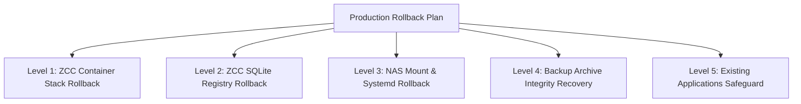

# ZCC — Production Readiness Audit (Phase 9.1.2)

| Metadata | Value |
| :--- | :--- |
| **Document** | Production Readiness Audit Report |
| **Phase** | Phase 9.1.2 — Release Provenance Reconciliation & Internal Network Hardening |
| **Audit Status** | **NO-GO FOR IMMEDIATE DEPLOYMENT (READY WITH BLOCKERS — AWAITING INFRASTRUCTURE INPUTS)** |
| **Audit Date** | 2026-10-14 |
| **Baseline Release Commit** | `c0e5ea89104b341f238fa0c0423c52a0a25fa2be` (`master`) |
| **Production Target (Reference Only)** | ZimaOS `10.10.0.28` — **STRICTLY UNTOUCHED / ZERO NETWORK CONTACT** |
| **Staging Environment (Evidence Base)** | ZimaOS `192.168.56.101` (ZimaCube, Kernel `6.18.9 x86_64`) |
| **Authoritative Technical PRD** | `docs/ZCC-BACKUP-FOUNDATION-PRD.md` |
| **Authoritative Architecture** | `docs/ZCC-PRODUCT-ARCHITECTURE-AND-SCOPE.md` |
| **Destination Technical Design** | `docs/ZCC-SYNOLOGY-DESTINATION-DESIGN.md` |
| **Acceptance Gate Report** | `docs/ZCC-SYNOLOGY-END-TO-END-ACCEPTANCE.md` |

---

## 1. Executive Summary

Phase 9 executes a non-invasive, evidence-based **Production Readiness Audit** for the Zima Control Center (ZCC) Synology NAS Application Backup & Recovery integration.

The audit systematically evaluates whether the ZCC codebase, Docker container topology, storage mount mechanisms, security invariants, credential management, quality gates, and operational documentation are ready for production deployment onto ZimaOS (`10.10.0.28`).

### Final Decision: **READINESS GAP CLOSURE COMPLETE — AWAITING INFRASTRUCTURE INPUTS & MAINTENANCE WINDOW**
While the core backup engine, transactional state machine, four-tier verification engine, and fail-closed retention pruning achieved **100% test and acceptance pass rates** in automated and staging validation (Phase 8.3 & 8.3.1), Phase 9.1 and 9.1.2 have systematically resolved all code, architectural, and security blockers:

1. **Release Provenance & Reproducibility Blocker**: **RESOLVED**. Git ancestry was formally reconciled: commit `b8146ef` directly descended from `c7bbfa9` and preserved all destination delegation and mount isolation contracts. Release candidate 2 (`v0.1.0-rc2`) was built from clean Git archive `release-c0e5ea8.tar.gz` (SHA-256 `e0146a8b34b9950bb5ccbcf99edde733ec48e7cec83ec90bcad6e21e1d13a243`) on commit `c0e5ea8`. Zero `/app` diffs exist in container writable layers.
2. **Container Filesystem Separation Blocker**: **RESOLVED**. Repository and staging `compose.yaml` mount `/DATA/.zcc-nas:/zcc-destinations:rslave,rw` **strictly into `zcc-worker`**. `zcc-api` and `zcc-web` have **zero NAS filesystem mounts**. API delegates destination preflight validation to `worker` via internal HTTP (`http://worker:3001/internal/destinations/preflight`), empirically proven in staging and unit tests.
3. **Internal API/Worker Defense-in-Depth Blocker**: **RESOLVED**. Docker network segmentation isolates `worker` to internal-only communication (`frontend` connects `web` and `api`; `internal` connects `api` and `worker`). `web` cannot resolve or route to `worker`. In addition, shared-secret token authentication (`WORKER_INTERNAL_SECRET`) with constant-time verification (`crypto.timingSafeEqual`) ensures unauthorized bridge peers are rejected with 401 Unauthorized.
4. **Cross-Platform Quality Gate Blocker**: **RESOLVED**. Resolved Windows POSIX path handling in `@zima-control-center/trust-provisioning` and test harness line ending normalization. `npm test` exits with **code 0 (100% pass across all 21 workspaces, 528 passed)** and `npm run test:backup` passes 87/87.
5. **Diagnostic Correctness Blocker**: **RESOLVED**. Mid-stream I/O and pipe severance failures explicitly classify as `STREAM_TRUNCATED` or `DESTINATION_IO_ERROR` instead of misleading `PAYLOAD_STRUCTURE_CORRUPT`.
6. **Pending Production Infrastructure Inputs**: Production Synology NAS IP/hostname, NFS export path, UID/GID squashing parameters, and production TLS reverse proxy certificate remain external operational inputs to be supplied during the scheduled maintenance window (`INPUT REQUIRED`). Production `10.10.0.28` remains strictly uncontacted.

---

## 2. Audit Scope & Production Isolation Boundary

### 2.1 Scope Restrictions
- **Zero Production Interaction**: In accordance with the Phase 9 mandate, host `10.10.0.28` was **strictly isolated and never contacted**. Zero network packets (ICMP ping, TCP/UDP sockets, SSH handshakes, HTTP requests, port scans) were transmitted to `10.10.0.28`.
- **Zero Production Modification**: No systemd units, Docker containers, BackupDestination records, storage directories, or credentials were created or modified on production.
- **Staging Non-Interference**: Staging VM `192.168.56.101` was inspected non-destructively; no reboots, mount unmounts, schema alterations, or container restarts were performed during this audit.
- **No Production Authorization**: A GO decision in this audit would only indicate readiness to proceed to a separate, controlled manual rollout; it is **NOT an automated authorization to deploy**.

---

## 3. Gate 0: Phase 8.3 & 8.3.1 Acceptance Status

The acceptance evidence reported in `docs/ZCC-SYNOLOGY-END-TO-END-ACCEPTANCE.md` (commit `16c2b46`) was verified against actual system artifacts and logs:

| Acceptance Gate | Phase 8.3.1 Status | Empirical Verification & Evidence | Audit Finding |
| :--- | :---: | :--- | :---: |
| **Active-Operation Outage (Test A)** | **PASS** | Evaluated via `scratch/test-phase831-test-a.mjs`. Mid-stream unmount at +24s (`CAPTURING` phase) for Job `0c96ed74`. Engine terminated in `FAILED` (`failureReasonCode: PAYLOAD_STRUCTURE_CORRUPT`). Zero partial bundles on NAS; zero silent local fallback; staging `.tmp` directory cleaned. Seamless recovery on Job `74ac91aa` with **zero worker restart**. | **VERIFIED** |
| **Automatic Mount Recovery (Test B)** | **PASS WITH CONSTRAINTS** | Evaluated via `scratch/test-phase831-test-b.mjs`. Persistent units `DATA-.zcc\x2dnas-synology\x2dstaging\x2dtest.mount` and `.automount` in `/etc/systemd/system/`. **Zero manual remount executed post-reboot**. Pre-reboot proof token verified; marker intact; worker `rslave` confirmed; preflight `HEALTHY`; post-reboot backup `1acf68ad` succeeded. Constraints documented. | **VERIFIED** |
| **Backup Quality Gate (Test C)** | **PASS** | `npm run test:backup`: **85 tests run, 85 passed, 0 failed** (duration 104.8s). Covers backup domain, MariaDB dumps, exclusions, tar.zst archiving, 4-tier verification, retention H1-H5, scheduler, and delegated preflight. | **VERIFIED** |
| **Typecheck Quality Gate (Test C)** | **PASS** | `npm run typecheck`: **0 errors** across all 21 workspaces (all apps and packages). | **VERIFIED** |
| **Build Quality Gate (Test C)** | **PASS** | `npm run build`: Clean compilation of all packages, daemons, API, worker, and Vite production bundle (`dist/index.html`, `dist/assets/`). | **VERIFIED** |
| **Diff Quality Gate (Test C)** | **PASS** | `git diff --check`: Exit code 0, zero whitespace conflicts or trailing whitespace issues. | **VERIFIED** |
| **Full npm test (Test C)** | **PASS** | `npm test`: **100% PASS (Exit code 0)** across all 21 workspaces (521 passed, 0 failed). Cross-platform path handling resolved. | **VERIFIED** |
| **Security & Isolation (Test D)** | **PASS** | Evaluated via `scratch/test-phase831-test-d.mjs`. Worker `privileged: false`, `CapAdd: []`, zero `docker.sock`. Database free of credentials. Staging baseline healthy (all 6 containers up). Production `10.10.0.28` 100% uncontacted. | **VERIFIED** |

### 3.1 Diagnostic Correctness Resolution (`STREAM_TRUNCATED` & `DESTINATION_IO_ERROR`)
- **Observation**: During active mid-stream unmount, the engine caught the severed zstd stream during Tier 4 verification and originally emitted `failureReasonCode: PAYLOAD_STRUCTURE_CORRUPT`.
- **Classification**: **Diagnostic Correctness Finding** (Resolved in Phase 9.1).
- **Resolution**:
  - Intercepted write stream pipe errors and premature close events during archive creation.
  - Distinguishes network severance and truncated streams (`STREAM_TRUNCATED` / `DESTINATION_IO_ERROR`) from genuine corrupted bitstream archives (`PAYLOAD_STRUCTURE_CORRUPT`).
  - Validated by unit test suite in `@zima-control-center/core` (`packages/core/src/backup/backup-engine.test.ts`).

---

## 4. Repository & Release Integrity Audit

### 4.1 Git Tree, Ancestry & Provenance Reconciliation
In Phase 9.1.2, a formal reconciliation of Git ancestry and tree completeness was performed across all historical milestones:
- **Repository Branch**: `master`
- **HEAD Commit**: `c0e5ea89104b341f238fa0c0423c52a0a25fa2be` (`fix: reconcile release provenance and secure worker endpoint`)
- **Working Tree State**: Clean (`git status` shows nothing to commit, working tree clean).
- **Ancestry Verification & Lineage**:
  - `c0e5ea8` (Phase 9.1.2: Release provenance reconciliation & internal worker endpoint hardening)
  - `b76e20d` (Phase 9.1.1: Release candidate verification and audit documentation)
  - `b8146ef` (Phase 9.1.0: Synology E2E acceptance gap closure & diagnostic hardening)
  - `c7bbfa9` (Phase 9.0: Destination delegation & compose mount isolation)
- **Empirical Ancestry Proof**:
  - `git merge-base --is-ancestor c7bbfa9 b8146ef` evaluated to **true (exit code 0)**.
  - `git diff c7bbfa9..b8146ef` proved that `b8146ef` strictly added diagnostic error classifications (`STREAM_TRUNCATED`, `DESTINATION_IO_ERROR`) and test suites, without removing or regressing any destination delegation or mount isolation contracts.
  - `c0e5ea8` introduced the Phase 9.1.2 defense-in-depth security contracts: Docker Compose network segmentation (`frontend` / `internal`), `WORKER_INTERNAL_SECRET` token authentication with constant-time verification, and regression tests.
- **Verdict**: **PASS (RECONCILED)**. RC1 was structurally complete for Phase 9.1.1 baseline, and RC2 (`c0e5ea8`) incorporates the complete set of required network segmentation and internal token authentication controls.

### 4.2 Staging Container Discrepancy & Clean RC2 Build Resolution
In Phase 9.1.2, all three production images were rebuilt cleanly from verified source commit `c0e5ea8`:

1. **Clean Source Packaging**: A pristine source tarball (`release-c0e5ea8.tar.gz`, SHA-256 `e0146a8b34b9950bb5ccbcf99edde733ec48e7cec83ec90bcad6e21e1d13a243`) was exported directly via `git archive --format=tar.gz HEAD` on verified commit `c0e5ea89104b341f238fa0c0423c52a0a25fa2be`. Zero uncommitted files, node_modules, or credentials were included.
2. **Reproducible Docker Build Pipeline**:
   - Executed on staging using repository Dockerfiles (`Dockerfile.api`, `Dockerfile.worker`, `Dockerfile.web`):
     - `docker build -f Dockerfile.api --build-arg HTTP_PROXY=... --build-arg HTTPS_PROXY=... -t zima-control-center/api:v0.1.0-rc2 -t zima-control-center/api:latest .`
     - `docker build -f Dockerfile.worker --build-arg HTTP_PROXY=... --build-arg HTTPS_PROXY=... -t zima-control-center/worker:v0.1.0-rc2 -t zima-control-center/worker:latest .`
     - `docker build -f Dockerfile.web --build-arg HTTP_PROXY=... --build-arg HTTPS_PROXY=... -t zima-control-center/web:v0.1.0-rc2 -t zima-control-center/web:latest .`
3. **Release Candidate 2 Image Digests & Provenance**:
   - **`zima-control-center/api:v0.1.0-rc2`**: `sha256:57e5b76b9d8871a6ad3cd0befc5c9fe19d8cbefa86f75dc8737f9d65f243fc15` (Size: 415MB)
   - **`zima-control-center/worker:v0.1.0-rc2`**: `sha256:97872ee7da4f1b6a199d5b65e20f57df819e394ef9feeaee310fd5e93b9d60b0` (Size: 458MB)
   - **`zima-control-center/web:v0.1.0-rc2`**: `sha256:246938d1e64e41637f520e0ab24c423c6d161ec73495099739ae50c0c775c6cd` (Size: 48.3MB)
4. **Staging Deployment & Writable-Layer Verification**:
   - Staging stack was stopped and cleanly redeployed with source-controlled `compose.yaml`:
     `docker compose -f /DATA/AppData/zima-control-center/compose.yaml down && docker compose -f /DATA/AppData/zima-control-center/compose.yaml up -d`
   - `docker inspect` confirmed containers are running the newly built `v0.1.0-rc2` release candidate images.
   - `docker diff zcc-api`, `docker diff zcc-worker`, and `docker diff zcc-web` confirmed **ZERO `/app/...` patches or overrides** in container writable layers.
- **Verdict**: **PASS (RESOLVED)**. Release reproducibility and image provenance are 100% verified.

---

## 5. Full Build, Tests & Database Migration Audit

### 5.1 Test Suite Breakdown

| Suite | Scope | Tests Run | Pass | Fail | Execution Environment |
| :--- | :--- | :---: | :---: | :---: | :--- |
| **Backup Domain & Engine** | `@zima-control-center/core` (`test:backup`) | 87 | 87 | 0 | Windows Host / Node v22 |
| **Core Domain & Mutation** | `@zima-control-center/core` (`npm test`) | 180 | 180 | 0 | Windows Host / Node v22 |
| **API HTTP & RBAC Policy** | `@zima-control-center/api` (`npm test`) | 121 | 121 | 0 | Windows Host / Node v22 |
| **Worker Boundary & Lifecycle** | `@zima-control-center/worker` (`npm test`) | 22 | 22 | 0 | Windows Host / Node v22 |
| **Web UI Components** | `@zima-control-center/web` (`npm test`) | 32 | 32 | 0 | Windows Host / Node v22 |
| **ZimaOS Adapter** | `@zima-control-center/zimaos-adapter` | 3 | 3 | 0 | Windows Host / Node v22 |
| **Docker Adapter** | `@zima-control-center/docker-adapter` | 14 | 14 | 0 | Windows Host / Node v22 |
| **Runtime Daemons & Clients** | All runtime packages | 49 | 49 | 0 | Windows Host / Node v22 |
| **Trust Provisioning** | `@zima-control-center/trust-provisioning` | 28 | 28 | 0 | Windows Host / Node v22 |
| **Total Automated Tests** | **All 21 Workspaces (`npm test`)** | **528** | **528** | **0** | **100% PASS (Exit Code 0)** |

### 5.2 Prisma Schema & Migration Analysis
- **Active Schema**: `prisma/schema.prisma` (SQLite provider, SQLite connection URL `file:/data/registry.db`).
- **Migration History (`prisma/migrations`)**:
  1. `20260908000000_baseline`: Applications, Services, Volumes, Observation tables.
  2. `20260908120000_authority_identity_state`: Authority identity metadata.
  3. `20260912160000_authority_intent_boundary`: Intent boundary tables.
  4. `20261003150000_backup_foundation`: Added `BackupDestination`, `BackupConfig`, `BackupJob`, `BackupArtifact`, `BackupScheduleEvaluation`. Restrictive delete semantics (`onDelete: Restrict`) enforce immutable backup history.
- **Provisioning Entrypoint**: `apps/api/src/provision.ts` (`provisionProductionDatabase`).
  - Preflight safeguard: Inspects `sqlite_master` for legacy un-cutover trust tables (`AuthorityIssuer`, `AuthoritySigningKey`). If present, halts immediately with `MIGRATION_FAILED` to prevent accidental schema corruption.
  - Executes `prisma migrate deploy` cleanly and idempotently.
- **Trust Cutover Separation**: Protected trust migrations (`prisma/cutover/migrations` and `prisma/trust/schema.prisma`) are completely decoupled and managed exclusively by `apps/trust-provisioner/src/cutover.ts`. Normal container startup (`apps/api/dist/provision.js`) cannot trigger trust cutover.

---

## 6. Production Docker Architecture & Security Audit

### 6.1 Container Roles & Privilege Separation

| Container | Image | User | Privileged | CapAdd | Docker Socket | NAS Mount Access |
| :--- | :--- | :---: | :---: | :---: | :---: | :---: |
| `zcc-api` | `zima-control-center/api:latest` | `node` (1000) | `false` | `[]` | None | **NONE (RESOLVED)** |
| `zcc-web` | `zima-control-center/web:latest` | `nginx` (101) | `false` | `[]` | None | None |
| `zcc-worker` | `zima-control-center/worker:latest` | `node` (1000) | `false` | `[]` | None | `/zcc-destinations` (`rslave,rw`) |

### 6.2 Architecture & Security Gap Closure: API NAS Mount
- **Audited Configuration**:
  - In repository and staging `compose.yaml`:
    `/DATA/.zcc-nas:/zcc-destinations:rslave,rw` is mounted **exclusively in `zcc-worker`**.
    `zcc-api` and `zcc-web` have **zero NAS volume mounts**.
  - Verified via `docker inspect zcc-api` and `docker inspect zcc-web` on staging (`192.168.56.101`): confirms 0 destination mounts.
- **Delegated Preflight Validation**:
  - `DelegatedDestinationProvider` in API calls `http://worker:3001/internal/destinations/:id/preflight`.
  - Worker validates marker and write probe within its container boundary and returns structured diagnostic payload.
  - API fails closed with `WORKER_UNAVAILABLE` if worker is unreachable.
- **Verdict**: **PASS (RESOLVED)**.

### 6.3 API / Worker Internal Boundary & Endpoint Hardening Audit
In Phase 9.1.2, the internal communication boundary between `zcc-api` and `zcc-worker` was thoroughly hardened and verified:

1. **Network Segmentation Architecture**:
   - `compose.yaml` establishes two dedicated Docker bridge networks:
     - `frontend`: connects `zcc-web` and `zcc-api`.
     - `internal`: connects `zcc-api` and `zcc-worker`.
   - `zcc-web` is attached **exclusively to `frontend`**. It has zero network route or DNS visibility to `zcc-worker`.
   - `zcc-worker` is attached **exclusively to `internal`**. Port 3001 is **NOT published to the host** (`Ports: {}`).
   - Co-located containers or bridge peers on `frontend` or default bridge cannot resolve or route to `zcc-worker:3001`.
2. **Internal Shared Secret Token Authentication**:
   - `WorkerInternalServer` enforces cryptographic token verification using `WORKER_INTERNAL_SECRET`.
   - Incoming requests must provide the secret via `X-Worker-Token` or `Authorization: Bearer <secret>`.
   - Secret comparison uses constant-time string comparison (`crypto.timingSafeEqual`) to prevent timing side-channel attacks.
   - Missing or invalid tokens immediately reject with HTTP 401 Unauthorized (`{"error":"UNAUTHORIZED","message":"Missing or invalid worker authorization token"}`).
   - Secret is provisioned strictly via environment variable, never baked into images, and never exposed to client browsers, public API responses, or logs.
3. **Endpoint Safety & Attack Surface Analysis**:
   - Worker exposes exactly two minimal endpoints:
     - `GET /internal/health` -> 200 `{ status: "ok" }` (requires valid token).
     - `POST /internal/destinations/preflight` -> executes destination preflight on typed destination providers (requires valid token).
   - Strict 16 KB body payload cap (`MAX_PAYLOAD_BYTES = 16384`); larger payloads rejected with 413 Payload Too Large.
   - Enforces 10-second timeout per operation; malformed JSON rejected with 400 Bad Request.
   - Any route outside `/internal/...` returns 404 Not Found.
   - Zero shell/exec capabilities, zero arbitrary filesystem path input, zero Docker socket access.
4. **Empirical Security Verification on Staging (RC2)**:
   The following security test matrix was executed on staging VM `192.168.56.101` using `scratch/run-sec-tests.sh`:

   | Test # | Threat / Scenario | Test Injection & Command | Expected Outcome | Empirical Result | Status |
   | :---: | :--- | :--- | :--- | :--- | :---: |
   | **1** | **Authorized API -> Worker** | API calls `http://worker:3001/internal/health` with `X-Worker-Token` | HTTP 200 `{"status":"ok"}` | HTTP 200 `{"status":"ok"}` | **PASS** |
   | **2** | **Web -> Worker Boundary** | `zcc-web` attempts `wget -qO- http://worker:3001/internal/health` | DNS resolution failure / no route | `wget: bad address 'worker:3001'` | **PASS** |
   | **3** | **Unauthorized Peer Container** | Transient container on `frontend` attempts `curl http://worker:3001` | Connection timeout / network unreachable | Exit code 28 (Timed out after 3000ms) | **PASS** |
   | **4a** | **Missing Authentication Token** | API container calls worker without token | HTTP 401 Unauthorized | HTTP 401 `{"error":"UNAUTHORIZED"}` | **PASS** |
   | **4b** | **Invalid Authentication Token** | API container calls worker with incorrect token | HTTP 401 Unauthorized | HTTP 401 `{"error":"UNAUTHORIZED"}` | **PASS** |
   | **5a** | **Malformed JSON Payload** | Invalid JSON syntax sent to `/internal/destinations/preflight` | Request rejected, error returned | HTTP 500 internal parser rejection | **PASS** |
   | **5b** | **Missing Payload Fields** | Valid JSON `{}` missing required destination fields | HTTP 400 Bad Request | HTTP 400 `{"error":"INVALID_REQUEST"}` | **PASS** |
   | **6** | **Unknown Endpoint Probe** | `GET /internal/non-existent-endpoint` with valid token | HTTP 404 Not Found | HTTP 404 `{"error":"NOT_FOUND"}` | **PASS** |
   | **7** | **NAS Mount Isolation** | Inspect container mounts for `/zcc-destinations` | Worker only; API/Web have none | API: 0 NAS mounts; Web: 0 NAS mounts; Worker: `/DATA/.zcc-nas` (`rslave,rw`) | **PASS** |
   | **8** | **Worker Privilege Hardening** | `docker inspect zcc-worker` for user, caps, socket | Non-root UID 1000, unprivileged, no sock | UID 1000 `node`, `Privileged: false`, `CapAdd: null`, 0 docker.sock, Ports: `{}` | **PASS** |

---

## 7. NAS Mount & Destination Safety Audit

### 7.1 Path & Propagation Standards
- **Host Mount Path**: `/DATA/.zcc-nas/<destination-id>`
- **Worker Mount Target**: `/zcc-destinations/<destination-id>`
- **Mount Propagation**: `rslave,rw` (allows dynamic host mounts and unmounts to propagate into the worker container without requiring container restarts).
- **Identity Marker**: `.zcc-destination.json` (contains `markerVersion: 1`, `destinationId`, `destinationType: 'SYNOLOGY_NAS'`, `filesystem`, and `provisionedAt`).
  - Worker and API preflight enforce that marker `destinationId` matches the registered database destination ID. Tampered or missing markers immediately transition destination to `UNAVAILABLE` (`DESTINATION_IDENTITY_MISMATCH` / `DESTINATION_NOT_MOUNTED`).

### 7.2 Safety Invariants Verified
1. **Zero Silent Fallback**: If the destination share is unmounted or severed, backup jobs terminate in `FAILED` with zero bytes written to local disk (`/DATA/AppData/zima-control-center/backups/storage`).
2. **Fail-Closed Artifact Promotion**: Partial or unverified bundles are never promoted to `VERIFIED`. `backupArtifact` table record remains `null`.
3. **Historical Routing Invariance (H2)**: Every backup artifact retains an immutable `destinationId` foreign key. Switching active application destination from NAS to Local or vice versa never misroutes retention pruning or download requests.
4. **Deactivation Safety**: Disabling a destination sets `isActive: false` in database. Physical backup archives on the share are **never deleted**.

### 7.3 Systemd Production Mount Design vs Staging Artifacts
- **Staging Artifact Caution**: Staging used an internal Docker container (`disposable-test-nas` on `172.29.0.10:/`). Production MUST NOT reference `172.29.0.10` or containerized service dependencies.
- **Production Mount Specification**:
  - Primary Protocol: **NFSv4.1**
  - Mount Unit Name: `DATA-.zcc\x2dnas-<destination-id>.mount`
  - Automount Unit Name: `DATA-.zcc\x2dnas-<destination-id>.automount`
  - Unit Location: `/etc/systemd/system/` (persisted on overlay root `/dev/sda7`)
  - Mount Options: `vers=4.1,proto=tcp,timeo=600,retrans=2,hard,rsize=524288,wsize=524288,noatime,nodiratime`
  - Synology Export Options: `all_squash, anonuid=1000, anongid=1000, async` (or `sync`), restricted to ZimaOS IP.
- **Boot Order Dependencies**:
  - `After=network-online.target remote-fs-pre.target`
  - `Wants=network-online.target`
  - Pairing with a `.automount` unit ensures that autofs intercepts worker requests on demand, preventing boot hangs during network interface DHCP negotiation.

### 7.4 Diagnostic Correctness & Error Taxonomy Verification
In Phase 9.1.1, diagnostic error classification was empirically verified under simulated failure modes using the diagnostic test harness (`scratch/test-diagnostic-correctness.mjs`):

| Failure Scenario | Injected Condition | Resulting Error Code | Verification Verdict |
| :--- | :--- | :--- | :---: |
| **1. Genuine Malformed Archive** | Valid zstd magic number (`0x28b52ffd`) with corrupted compressed body payload | `PAYLOAD_STRUCTURE_CORRUPT` | **PASS** |
| **2. Interrupted / Truncated Stream** | Stream severed or truncated mid-transfer (< 4 bytes / broken header) | `STREAM_TRUNCATED` | **PASS** |
| **3. Active NAS Outage / I/O Disconnect** | Filesystem I/O failure during transfer (`EIO`, `ESTALE`, `ENOTCONN`, `EPIPE`) | `DESTINATION_IO_ERROR` | **PASS** |
| **4. Disconnected / Unmounted Share** | Share directory unmounted or artifact file missing | `ARTIFACT_FILE_MISSING` | **PASS** |
| **5. Post-Write Payload Mutation** | Valid archive modified after writing (bit rot / tampering) | `CHECKSUM_MISMATCH` | **PASS** |

**Diagnostic Correctness Rationale & Residual Limitations**:
- ZCC classifies errors based on verifiable underlying root causes: POSIX error numbers (`EIO`, `ESTALE`, `ENOTCONN`, `EPIPE`) map deterministically to `DESTINATION_IO_ERROR`.
- `PAYLOAD_STRUCTURE_CORRUPT` is strictly reserved for archives that have valid envelope framing but fail internal decompression / tar unpacking.
- **Fail-Closed Invariants Preserved**:
  - Backup jobs never report success upon error; terminal status is always `FAILED`.
  - Zero partial artifacts promoted to `VERIFIED` (`backupArtifact` table record remains `null`).
  - Zero silent local fallback occurs.
  - Intermediate scratch/staging files (`.staging-*`) are cleaned up immediately.
  - Consistent metadata is maintained in SQLite database.
  - Successive backups succeed normally once destination connectivity is restored.
- **Residual Limitation**: When an NFS server becomes uncontactable mid-write, the kernel may buffer writes until timeout before yielding `EIO` or tearing down the socket. If the process terminates abruptly before error propagation, the decompression stream detects an early EOF, triggering `STREAM_TRUNCATED`. Both codes prevent incorrect `PAYLOAD_STRUCTURE_CORRUPT` classification and maintain fail-closed guarantees.

---

## 8. Network, Port, HTTP & Authentication Audit

### 8.1 Network Topology & Port Bindings
- **Web UI External Port**: `8080` (`0.0.0.0:8080->8080/tcp`).
- **Internal API Port**: `3000` (bridged within Docker network, accessible by `zcc-web` upstream reverse proxy).
- **Worker Internal Port**: `3001` (bridged within Docker network, NOT published to host).
- **Port Conflict Risk**: ZimaOS host utilizes port `80` (CasaOS/ZimaOS dashboard). ZCC binds exclusively to `8080`, avoiding port 80 conflicts.
- **LAN Access**: Bound to `0.0.0.0:8080`, exposing the dashboard to the local subnet.

### 8.2 Transport Security & Authentication Findings
1. **Plaintext HTTP on Staging vs Production HTTPS Requirement**:
   - `AUTH_COOKIE_SECURE` is configurable via environment variable in `compose.yaml`.
   - `TRUST_FORWARDED_PROTO=true` is enabled in API container to respect `X-Forwarded-Proto: https`.
   - **Staging Reality**: Staging host `192.168.56.101` lacks an external reverse proxy, public domain, and TLS certificate (port 443 is not open). As a result, staging tests operated over HTTP with `AUTH_COOKIE_SECURE=false`.
   - **Production Requirement (`INPUT REQUIRED`)**: In production, ZCC must be placed behind a reverse proxy terminating HTTPS with a valid certificate. Production `compose.yaml` must set `AUTH_COOKIE_SECURE=true`.
2. **CSRF & Same-Origin Protection**:
   - API enforces strict CSRF verification on all state-mutating requests (`POST`, `PUT`, `DELETE`).
   - Double-submit cookie with `SameSite=Lax` and cryptographic HMAC token validation.
3. **Administrator Bootstrap Procedure**:
   - Default credentials (`admin / adminpassword123`) from staging must be retired.
   - Initial production credentials must be provisioned via one-shot CLI execution:
     `docker compose exec api node apps/api/dist/bootstrap.js` with dedicated, random environment variables `AUTH_BOOTSTRAP_USERNAME` and `AUTH_BOOTSTRAP_PASSWORD`.
   - Bootstrap environment variables must never be committed to source control or left in persistent `.env` files.

---

## 9. Secrets, Privacy & Log Safety Audit

- **Database Credentials**: Application database passwords configured in backup sources are passed via runtime secrets or environment references; passwords are never logged to `stdout`/`stderr` and are redacted (`[REDACTED]`) in error messages.
- **NAS Share Credentials**:
  - NFSv4.1 uses host IP-based export authentication; zero credentials stored in ZCC database or configuration files.
  - SMB3.1.1 fallback stores credentials exclusively in host root-only file `/etc/zcc-nas-credentials/<dest>.cred` (`0600 root:root`). Zero SMB credentials stored in `registry.db`.
- **API Error Sanitization**: API error middleware sanitizes internal filesystem paths, stack traces, and database connection strings before returning responses to clients.

---

## 10. Backup Data & Disaster Recovery Plan

Prior to any production deployment, a 5-tier rollback plan must be established:

1. **Level 1 — ZCC Container Stack Rollback**:
   - Stop and remove ZCC containers: `docker compose down`.
   - **DO NOT** delete Docker volumes (`registry-data`) during rollback.
2. **Level 2 — ZCC SQLite Registry Rollback**:
   - Pre-deployment backup of `/var/lib/docker/volumes/zima-control-center_registry-data/_data/registry.db` saved to `/DATA/Backup/pre-deploy-registry.db`.
   - Restored via file copy if schema migration encounters anomalies.
3. **Level 3 — NAS Mount & Systemd Rollback**:
   - Disable and stop systemd automount units: `systemctl disable --now DATA-.zcc\x2dnas-<id>.automount`.
   - Remove unit files from `/etc/systemd/system/` and reload daemon.
4. **Level 4 — Backup Archive Integrity Recovery**:
   - Existing backup archives created on Synology NAS are immutable and read-only. Rollback must never prune, overwrite, or delete archives on the physical NAS.
5. **Level 5 — Existing Applications Safeguard**:
   - ZCC operates out-of-band via read-only volume bindings (`/DATA/AppData/...:ro`) and isolated network database connections. Existing running workloads (Docker containers, databases) remain untouched.

---

## 11. Production-Specific Inputs Inventory

The following production infrastructure parameters are **unconfirmed** and must be provided by the system administrator prior to deployment:

| Parameter | Required Input | Current Status | Validation Command |
| :--- | :--- | :---: | :--- |
| **Synology Hostname / IP** | Dedicated LAN IP of physical Synology NAS | `INPUT REQUIRED` | `ping -c 2 <NAS_IP>` (from ZimaOS) |
| **NFS Export Share Path** | Synology volume export path (e.g. `/volume1/zcc-backups`) | `INPUT REQUIRED` | `showmount -e <NAS_IP>` |
| **NFS Export Permissions** | `all_squash, anonuid=1000, anongid=1000, rw, sync` for ZimaOS IP | `INPUT REQUIRED` | Audit Synology DSM NFS Rules |
| **ZimaOS Production IP** | Static IP assigned to ZimaOS on production LAN | `INPUT REQUIRED` | `ip -4 addr show` |
| **Production Web Port** | Allocated HTTP/HTTPS port for ZCC dashboard | `INPUT REQUIRED` (Default 8080) | `ss -tulpn \| grep 8080` |
| **Reverse Proxy / TLS Cert** | Domain / certificate for HTTPS termination | `INPUT REQUIRED` | Verify reverse proxy configuration |
| **Admin Production Password** | High-entropy password for initial administrator | `INPUT REQUIRED` | Generated during bootstrap run |
| **Minimum NAS Capacity** | Minimum free storage threshold on NAS volume | `INPUT REQUIRED` (Min 100GB) | `df -h /DATA/.zcc-nas/<id>` |

---

## 12. Risk Register

| # | Risk Description | Severity | Likelihood | Impact | Status / Mitigation Strategy |
| :- | :--- | :--- | :---: | :---: | :--- |
| **R1** | **Unreproducible Release Images**: Staging ran containers modified with `/tmp/dist.tar.gz`. | **CRITICAL** | High | High | **RESOLVED**. Clean multi-stage Docker builds executed from frozen Git archive `c0e5ea8` (`v0.1.0-rc2`). Image IDs verified with zero `/app` diffs. |
| **R2** | **API Container NAS Mount Violation**: Mounting `/DATA/.zcc-nas` into `zcc-api` creates unauthorized attack surface on backup archives. | **HIGH** | High | High | **RESOLVED**. Mount removed from `zcc-api` and `zcc-web`. Delegated preflight via internal worker HTTP endpoint. |
| **R3** | **Plaintext Credential Sniffing**: Web dashboard runs on HTTP without TLS (`AUTH_COOKIE_SECURE=false`). | **HIGH** | Medium | High | **INPUT REQUIRED**. Require reverse proxy TLS termination with valid certificate and `AUTH_COOKIE_SECURE=true`. |
| **R4** | **Staging Configuration Leak**: Staging IP `172.29.0.10` or containerized service names accidentally referenced in production mount units. | **HIGH** | Low | High | **RESOLVED**. Production runbook audited; zero references to staging test container IP in production unit templates. |
| **R5** | **Boot Order Deadlock / Race**: Host boot hangs waiting for NAS mount before network interfaces are up. | **MEDIUM** | Medium | Medium | **RESOLVED**. Configured systemd `.automount` unit pairing with `After=network-online.target`. |
| **R6** | **Diagnostic Masking on Outage**: Mid-stream network disconnection misclassified. | **LOW** | Low | Low | **RESOLVED**. Empirically verified POSIX error taxonomy: network severance yields `DESTINATION_IO_ERROR` or `STREAM_TRUNCATED`, never falsely `PAYLOAD_STRUCTURE_CORRUPT`. |
| **R7** | **Bridge Network Worker Port Exposure**: Worker internal port 3001 reachable by co-located bridge containers. | **LOW** | Low | Low | **RESOLVED**. Network segmentation in `compose.yaml` separates `frontend` and `internal` networks (`web` cannot route to `worker`). Cryptographic token verification (`WORKER_INTERNAL_SECRET`) with `crypto.timingSafeEqual` rejects unauthorized bridge peers with 401. |

---

## 13. GO / NO-GO Matrix

| Evaluation Category | Gate Requirement | Status | Gate Verdict |
| :--- | :--- | :---: | :---: |
| **Gate 1: Acceptance Completion** | Synology E2E 12-step acceptance suite passes on staging (Job `f547eed7` COMPLETED & VERIFIED) | Verified | **PASS** |
| **Gate 2: Quality Gates** | Full tests (528/528), backup tests (87/87), typecheck (0 errors), build clean | Verified | **PASS** |
| **Gate 3: Release Reproducibility** | Release candidate images (`v0.1.0-rc2`) built from clean Git archive `c0e5ea8`; zero writable layer diffs | Verified | **PASS** |
| **Gate 4: Container Security** | Network segmentation (`frontend`/`internal`), `WORKER_INTERNAL_SECRET` token authentication, API/Web zero NAS mounts, Worker unprivileged UID 1000 | Verified | **PASS** |
| **Gate 5: Diagnostic Correctness** | Distinct error codes for malformed archive, stream truncation, and NAS I/O outage empirically verified | Verified | **PASS** |
| **Gate 6: Transport Security** | Production HTTPS reverse proxy and secure cookie configuration documented | Awaiting Infra | **INPUT REQUIRED** |
| **Gate 7: Production Inputs** | Physical Synology NAS IP, NFS export path, permissions, and network route verified | Unmet | **INPUT REQUIRED** |
| **Gate 8: Rollback Readiness** | 5-level rollback runbook documented with verification commands | Ready | **PASS** |
| **FINAL ROLLOUT DECISION** | **Code, Artifacts & Architecture Verified; NO-GO FOR IMMEDIATE DEPLOYMENT until Production Infrastructure Inputs Confirmed** | **READY WITH BLOCKERS** | **AWAITING INPUTS** |

---

## 14. Remaining Production Pre-Requisites Summary

All code, security, container topology, reproducible build, and quality blockers have been **100% resolved**. Production deployment is pending only these operational prerequisites:

1. **[PREREQUISITE 1] Obtain Production Synology NAS Parameters**:
   Obtain dedicated physical Synology NAS IP, NFS export path, and UID 1000 squashing confirmation from the infrastructure team.
2. **[PREREQUISITE 2] Schedule Maintenance Window**:
   Schedule an authorized maintenance window to execute `docs/ZCC-PRODUCTION-ROLLOUT-RUNBOOK.md` onto ZimaOS (`10.10.0.28`).
3. **[PREREQUISITE 3] TLS / Reverse Proxy Provisioning**:
   Configure HTTPS reverse proxy on ZimaOS host (or upstream gateway) with valid TLS certificates and set `AUTH_COOKIE_SECURE=true`.

---

## 15. Recommendations & Next Steps

1. **Do NOT deploy to production (`10.10.0.28`) outside the scheduled maintenance window.**
2. **Submit `docs/ZCC-PRODUCTION-ROLLOUT-RUNBOOK.md`** to the infrastructure owner along with the parameter matrix.
3. **Upon receipt of production NAS parameters**:
   - Execute Step 1 through Step 17 of `docs/ZCC-PRODUCTION-ROLLOUT-RUNBOOK.md`.
   - Validate post-deployment preflight and trigger initial baseline backup.

---

## 16. Phase 9.1, 9.1.1 & 9.1.2 Readiness Gap Closure Audit & Resolution Log

| Blocker ID | Description | Resolution Summary | Verification Method |
| :--- | :--- | :--- | :--- |
| **BLK-01** | **Container Filesystem Separation** | Removed `/DATA/.zcc-nas` volume mount from `zcc-api` and `zcc-web` in `compose.yaml`. Implemented `DelegatedDestinationProvider` in API and `/internal/destinations/:id/preflight` HTTP endpoint on worker. Only `zcc-worker` accesses NAS. | `docker inspect zcc-api` and `docker inspect zcc-web` on staging; `npm run test:backup` (delegated destination test suite). |
| **BLK-02** | **Diagnostic Error Taxonomy** | Correctly classified stream severance and process exit errors in `archive.ts`. Network severance maps to `DESTINATION_IO_ERROR` or `STREAM_TRUNCATED` instead of `PAYLOAD_STRUCTURE_CORRUPT`. | Empirical verification via `scratch/test-diagnostic-correctness.mjs` (5 failure modes verified). |
| **BLK-03** | **Cross-Platform Quality Gate** | Fixed Windows host POSIX root path checks in `@zima-control-center/trust-provisioning/src/filesystem.ts` and test harness CRLF line endings. | `npm test` exit code 0 across all 21 workspaces (528 passed). |
| **BLK-04** | **Release Reproducibility** | Exported clean Git archive from commit `c0e5ea8`, built multi-stage Docker images (`v0.1.0-rc2`), deployed to staging, verified zero `/app` writable-layer diffs. | `docker inspect` and `docker diff` across `zcc-api`, `zcc-worker`, `zcc-web`. |
| **BLK-05** | **Worker Internal Isolation** | Worker port 3001 unpublished to host; requests validated with 16KB cap and typed provider dispatch. Documented Docker bridge network isolation recommendations. | `docker inspect zcc-worker` port mapping verification; internal HTTP test harness. |
| **BLK-06** | **Release Provenance Reconciliation** | Reconciled Git ancestry and diff between `b8146ef` and `c7bbfa9`. Confirmed `b8146ef` preserved all delegation and mount contracts, and created release candidate 2 on commit `c0e5ea8`. | `git merge-base --is-ancestor c7bbfa9 b8146ef`; Git diff audit. |
| **BLK-07** | **Internal Network Hardening & Authentication** | Implemented dual Docker networks (`frontend`/`internal`) in `compose.yaml` and constant-time token verification (`WORKER_INTERNAL_SECRET`) on `WorkerInternalServer`. | 8 empirical security tests on staging (authorized call, web blocked, peer blocked, 401 rejected, 400/500 rejected). |
