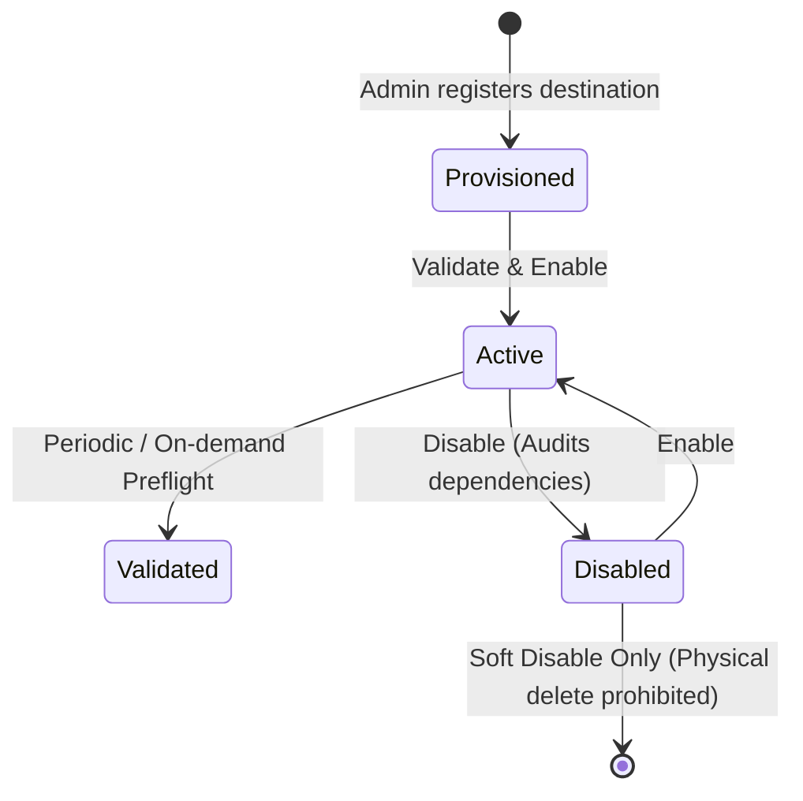

# ZCC Phase 8.1 — Backup Destination Management API & Provisioning Specification

| Field | Value |
| :--- | :--- |
| **Phase** | 8.1 — Backup Destination Management API & Provisioning |
| **Status** | **IMPLEMENTED & VERIFIED** |
| **Workspace** | `e:\project\zima-control-center` |
| **Primary References** | `docs/ZCC-PRODUCT-ARCHITECTURE-AND-SCOPE.md`, `docs/ZCC-SYNOLOGY-DESTINATION-DESIGN.md`, `docs/ZCC-SYNOLOGY-DESTINATION-HARDENING.md` |
| **Infrastructure Precedents** | `docs/ZCC-SYNOLOGY-STAGING-INFRA-AUDIT.md`, `docs/ZCC-SYNOLOGY-STAGING-NAS-VALIDATION.md` |
| **Target Platforms** | `LOCAL_FILESYSTEM` and `SYNOLOGY_NAS` |
| **Security Standards** | Zero credentials in ZCC DB/API, unprivileged non-root container, zero `docker.sock`, no `CAP_SYS_ADMIN` |
| **Staging Environment** | `192.168.56.101` (ZimaOS v1.7.1) |
| **Production Environment** | `10.10.0.28` — **Strictly untouched / not contacted** |
| **Date** | 2026-10-05 |

---

## 1. Executive Summary

Phase 8.1 implements the management workflow and REST API endpoints for `BackupDestination`. This enables administrators to register, inspect, update, validate, enable, and disable backup destinations for both **Local Filesystem** and **Synology NAS** storage targets in a deterministic, fail-closed, and secure manner.

Prior to Phase 8.1, destination definitions in the database were static, and destination manipulation lacked dedicated administration APIs, runtime health validation routes, dependency safety audits, and strict role-based access control (RBAC).

Phase 8.1 delivers:
1. **Administrative REST API**: Full lifecycle endpoints with RBAC enforcement (`VIEWER`, `OPERATOR`, `ADMIN`), CSRF token protection, and same-origin validation.
2. **Deterministic Identity Markers**: Cryptographic binding via `.zcc-destination.json` anchored to `destinationId` and `destinationType`.
3. **Comprehensive Health Validation**: Real-time probe testing mount accessibility, marker identity, atomic write capability, `fsync` persistence, and `statfs` capacity reporting.
4. **Deactivation Safety & Dependency Auditing**: Fail-closed conflict detection preventing disabling destinations that have in-flight jobs or active application configurations.
5. **Strict Security Boundaries**: Rejection of path traversal, shell injection characters, system directories, and unauthorized root paths. Zero storage of NAS credentials in database or API responses.

---

## 2. Destination Domain Model & Lifecycle

The domain model uses the persistent database schema defined in `prisma/schema.prisma` without requiring breaking schema migrations:

```prisma
model BackupDestination {
  id                 String          @id @default(uuid())
  name               String          @unique
  type               DestinationType // LOCAL_FILESYSTEM | SYNOLOGY_NAS
  basePath           String
  isActive           Boolean         @default(true)
  configJsonRedacted String?
  createdAt          DateTime        @default(now())
  updatedAt          DateTime        @updatedAt

  backupConfigs      BackupConfig[]
  artifacts          BackupArtifact[]
}
```

### Destination Types

- `LOCAL_FILESYSTEM`: Local storage on the host filesystem provisioned for container volume access (e.g. `/DATA/AppData/zima-control-center/backups`).
- `SYNOLOGY_NAS`: Network attached storage share mounted on the host by infrastructure (NFSv4.1 primary or SMB3 fallback) and exposed into the container namespace (e.g. `/zcc-destinations/synology-primary` or `/DATA/.zcc-nas/...`).

### Lifecycle States



1. **Provisioned**: Stored in registry with `isActive: true` or `false`.
2. **Active**: Eligible for binding in new `BackupConfig` records and receiving new `BackupJob` executions.
3. **Disabled**: Ineligible for new jobs or new configuration bindings. Historical artifacts and retention records remain intact. Physical deletion is strictly prohibited in Phase 8.1.

---

## 3. REST API Specification

All routes are mounted under `/api/backup-destinations` and enforce the existing authentication boundary, session cookies, CSRF tokens, and same-origin protection.

### Endpoint Summary

| Method | Endpoint | RBAC Role | Purpose |
| :--- | :--- | :--- | :--- |
| `GET` | `/api/backup-destinations` | `VIEWER`, `OPERATOR`, `ADMIN` | List all backup destinations with health status |
| `GET` | `/api/backup-destinations/:id` | `VIEWER`, `OPERATOR`, `ADMIN` | Get detailed destination status and dependency counts |
| `POST` | `/api/backup-destinations` | `ADMIN` | Register a new backup destination |
| `PATCH` | `/api/backup-destinations/:id` | `ADMIN` | Update destination name or basePath |
| `POST` | `/api/backup-destinations/:id/validate` | `OPERATOR`, `ADMIN` | Execute live preflight and probe health check |
| `POST` | `/api/backup-destinations/:id/enable` | `ADMIN` | Transition destination to active state |
| `POST` | `/api/backup-destinations/:id/disable` | `ADMIN` | Transition destination to inactive state (with safety check) |

---

### Detailed Endpoints

#### 1. List Destinations: `GET /api/backup-destinations`
- **RBAC**: `VIEWER`, `OPERATOR`, `ADMIN`
- **Query Parameters**: None
- **Response `200 OK`**:
```json
{
  "destinations": [
    {
      "id": "6e949d6e-6621-496a-a435-6c791a2b4ddd",
      "name": "staging-local-filesystem",
      "type": "LOCAL_FILESYSTEM",
      "basePath": "/DATA/AppData/zima-control-center/backups",
      "isActive": true,
      "displayLocation": "Local Filesystem",
      "health": {
        "status": "HEALTHY",
        "mounted": true,
        "writable": true,
        "availableBytes": "18253611008",
        "capacityBytes": "30064771072",
        "checkedAt": "2026-10-05T08:00:00.000Z"
      },
      "createdAt": "2026-10-03T12:00:00.000Z",
      "updatedAt": "2026-10-03T12:00:00.000Z"
    }
  ]
}
```

#### 2. Get Destination: `GET /api/backup-destinations/:id`
- **RBAC**: `VIEWER`, `OPERATOR`, `ADMIN`
- **Response `200 OK`**: Includes destination detail, full health status, and dependency counts:
```json
{
  "destination": {
    "id": "synology-staging-test",
    "name": "synology-nas-primary",
    "type": "SYNOLOGY_NAS",
    "basePath": "/zcc-destinations/synology-staging-test",
    "isActive": true,
    "displayLocation": "Synology NAS (/zcc-destinations/synology-staging-test)",
    "health": {
      "status": "HEALTHY",
      "mounted": true,
      "writable": true,
      "availableBytes": "18253611008",
      "capacityBytes": "30064771072",
      "checkedAt": "2026-10-05T08:01:00.000Z"
    },
    "dependencies": {
      "activeJobsCount": 0,
      "activeConfigsCount": 2,
      "retainedArtifactsCount": 6
    },
    "createdAt": "2026-10-04T16:00:00.000Z",
    "updatedAt": "2026-10-04T16:00:00.000Z"
  }
}
```
- **Response `404 Not Found`**: When destination ID does not exist (`BACKUP_DESTINATION_NOT_FOUND`).

#### 3. Create Destination: `POST /api/backup-destinations`
- **RBAC**: `ADMIN`
- **Request Headers**: `X-CSRF-Token: <token>`, `Origin: <origin>`
- **Request Body**:
```json
{
  "id": "synology-backup-01",
  "name": "synology-production-backup",
  "type": "SYNOLOGY_NAS",
  "basePath": "/zcc-destinations/synology-primary",
  "isActive": true,
  "config": {
    "host": "192.168.1.50",
    "share": "/volume1/zcc-backups"
  }
}
```
- **Validation Rules**:
  - `name`: Non-empty string, unique.
  - `type`: Must be `LOCAL_FILESYSTEM` or `SYNOLOGY_NAS`.
  - `basePath`: Absolute approved path (see Section 4).
  - No credential fields (`password`, `secret`, `smbCredential`, `key`) allowed in payload.
- **Response `201 Created`**: Returns created destination representation.

#### 4. Update Destination: `PATCH /api/backup-destinations/:id`
- **RBAC**: `ADMIN`
- **Request Body**:
```json
{
  "name": "synology-backup-renamed",
  "basePath": "/zcc-destinations/synology-secondary"
}
```
- **Response `200 OK`**: Returns updated destination representation.

#### 5. Validate Destination: `POST /api/backup-destinations/:id/validate`
- **RBAC**: `OPERATOR`, `ADMIN`
- **Response `200 OK`**:
```json
{
  "validation": {
    "destinationId": "synology-staging-test",
    "type": "SYNOLOGY_NAS",
    "status": "HEALTHY",
    "mounted": true,
    "writable": true,
    "capacityBytes": "30064771072",
    "availableBytes": "18253611008",
    "reason": null,
    "checkedAt": "2026-10-05T08:02:00.000Z"
  }
}
```
- If validation fails, `status` returns `UNAVAILABLE` or `DEGRADED` with a sanitized `reason`:
```json
{
  "validation": {
    "destinationId": "synology-staging-test",
    "type": "SYNOLOGY_NAS",
    "status": "UNAVAILABLE",
    "mounted": false,
    "writable": false,
    "capacityBytes": null,
    "availableBytes": null,
    "reason": "Destination identity marker .zcc-destination.json missing or unreadable",
    "checkedAt": "2026-10-05T08:02:00.000Z"
  }
}
```

#### 6. Enable Destination: `POST /api/backup-destinations/:id/enable`
- **RBAC**: `ADMIN`
- **Response `200 OK`**: Sets `isActive: true`.

#### 7. Disable Destination: `POST /api/backup-destinations/:id/disable`
- **RBAC**: `ADMIN`
- **Query Parameter**: `force=true|false` (default: `false`)
- **Safety Semantics**:
  - If destination has active in-flight jobs (`QUEUED`, `INITIALIZING`, `CAPTURING`, `VERIFYING`): **Rejects with `409 Conflict`**. Forcing is rejected; active jobs must complete or fail first.
  - If destination is bound to active `BackupConfig` records and `force=false`: **Rejects with `409 Conflict`** indicating the number of bound configs.
  - If `force=true`: Transitions `isActive: false`. Running jobs are not impacted (job captures freeze destination identity at job creation).
  - Historical artifacts and files on the destination are **NEVER deleted**.
- **Response `200 OK`**:
```json
{
  "destination": {
    "id": "synology-staging-test",
    "isActive": false,
    "updatedAt": "2026-10-05T08:05:00.000Z"
  }
}
```

---

## 4. Path Containment & Security Rules

### Approved Base Path Verification (`assertApprovedBasePath`)

`assertApprovedBasePath` strictly validates `destination.basePath`:
1. **Character Invariants**: Traversal sequences (`..`), null bytes (`\0`), shell metacharacters (`;`, `&`, `|`, `` ` ``, `$`, `>`, `<`) are rejected fail-closed.
2. **System Root Invariants**: Rejects host system directories: `/etc`, `/sys`, `/proc`, `/dev`, `/boot`, `/lib`, `/bin`, `/sbin`, `/usr`, `/root`, `/var/run`.
3. **Approved Storage Roots**:
   - `LOCAL_FILESYSTEM`: Must reside within `/DATA/AppData/` or `/DATA/AppData/zima-control-center/backups`.
   - `SYNOLOGY_NAS`: Must reside within approved mount roots: `/zcc-destinations/`, `/DATA/.zcc-nas/`, `/DATA/mnt/`, or `/mnt/`.
4. **Sanitized Display**: Never returns internal mount secrets or raw filesystem hierarchies to the UI. Returns clean locations such as `"Local Filesystem"` or `"Synology NAS (/zcc-destinations/synology-primary)"`.

---

## 5. Destination Identity Marker (`.zcc-destination.json`)

To prevent catastrophic misdirection (e.g. unmounted mountpoints exposing the local root partition, or cross-mounting wrong shares), every `SYNOLOGY_NAS` destination must contain a cryptographically verifiable identity marker:

```json
{
  "markerVersion": 1,
  "destinationId": "synology-staging-test",
  "destinationType": "SYNOLOGY_NAS",
  "filesystem": "nfs4",
  "provisionedAt": "2026-10-05T08:00:00.000Z"
}
```

### Marker Rules:
- **Binding**: Bound directly to `destinationId` and `destinationType`. Hostname and IP are not used as sole identity markers.
- **File Mode**: Permissions `0640` with ownership `1000:1000`.
- **Validation Check**: Preflight checks:
  1. File exists at `<basePath>/.zcc-destination.json`.
  2. Parses as valid JSON with `markerVersion: 1`.
  3. `marker.destinationId === destination.id`.
  4. `marker.destinationType === destination.type`.
- **Mismatch / Absence**: Immediate fail-closed abort. Zero backup writes, zero retention prunes, zero metadata modifications.

---

## 6. Preflight Validation Semantics

When `POST /api/backup-destinations/:id/validate` or worker preflight runs:

```
[Target Destination]
       │
       ▼
 1. Check destination.isActive === true (Fail -> UNAVAILABLE)
       │
       ▼
 2. Check provider registry supports destination.type (Fail -> UNAVAILABLE)
       │
       ▼
 3. fs.access(basePath) (Fail -> DESTINATION_NOT_MOUNTED)
       │
       ▼
 4. Read & Validate .zcc-destination.json (Fail -> MARKER_MISSING / MARKER_MISMATCH)
       │
       ▼
 5. Write probe: fs.writeFile(staging/.probe-<uuid>, conv=fdatasync) (Fail -> DESTINATION_NOT_WRITABLE)
       │
       ▼
 6. statfs(basePath) for capacity & available bytes (Fail -> CAPACITY_UNAVAILABLE)
       │
       ▼
 7. Clean up probe: fs.unlink(staging/.probe-<uuid>)
       │
       ▼
 [Return Sanitized Preflight Health: HEALTHY]
```

All filesystem I/O operations are bounded by a strict 15-second timeout (`DESTINATION_TIMEOUT`) to prevent hung NFS/SMB network RPC calls from blocking the ZCC event loop.

---

## 7. Configuration & Job Integration Rules

1. **Explicit Binding**:
   - `BackupConfig` binds to a specific `destinationId`.
   - When updating `BackupConfig`, omitting `destinationId` strictly preserves the existing binding.
   - Creating a `BackupConfig` without `destinationId` falls back to the default active `LOCAL_FILESYSTEM`.
   - Inactive or non-existent `destinationId` is rejected with `400 Bad Request`.
2. **Immutable Job Identity**:
   - When a `BackupJob` is created, its `destinationId` is captured and frozen for the life of that job.
3. **Immutable Historical Artifacts**:
   - Every `BackupArtifact` preserves `artifact.destinationId`.
   - Switching an application's destination from Destination A to Destination B leaves all historical artifacts on Destination A completely intact.
   - Retention pruning inspects `artifact.destinationId` per artifact. Pruning artifacts on Destination A will never attempt to prune Destination B.

---

## 8. Deactivation & Deletion Safety

1. **Soft Disable Only**:
   - Physical deletion of destinations is intentionally disabled in Phase 8.1.
   - No `DELETE /api/backup-destinations/:id` route is exposed.
   - Disabling a destination sets `isActive: false` in the database.
2. **Zero Physical Destruction**:
   - Disabling a destination never deletes filesystem files, backup bundles, manifests, or checksums.
   - Historical artifacts remain accessible and verified in the database.
3. **Conflict Protection**:
   - Disabling a destination with active in-flight jobs is blocked (`409 Conflict`).
   - Disabling a destination with active configurations requires explicit confirmation (`force=true`).

---

## 9. Security Boundary Invariants

- **Host vs Container Separation**: Worker container runs as unprivileged non-root user `node` (UID 1000, GID 1000).
- **No Docker Socket**: Zero `/var/run/docker.sock` exposure in API or Worker containers.
- **No Elevated Privileges**: Containers run with `privileged: false`, empty `CapAdd` (no `CAP_SYS_ADMIN`).
- **No Credentials in ZCC**: NAS authentication (NFS IP squash or SMB credentials) is an infrastructure concern handled entirely by the host OS kernel. ZCC never stores, processes, or exposes credentials.
- **Production Isolation**: Production environment (`10.10.0.28`) was strictly untouched. All testing executed on staging VM (`192.168.56.101`).
