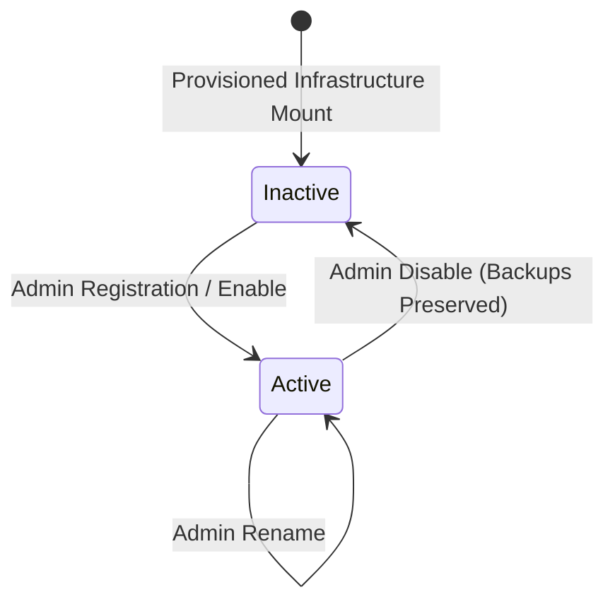

# ZCC Phase 8.2 — Synology Destination Management UI Specification & Architecture

## Overview

Phase 8.2 delivers the user interface and client integration for the `BackupDestination` capability introduced in Phase 8.1. It provides administrative controls, operational preflight health validation, and seamless integration with application backup workflows while upholding strict security invariants.

---

## 1. UI Routes & Navigation

| Route | View Component | Access Role | Description |
|---|---|---|---|
| `/backup-destinations` | `renderBackupDestinationsPage` | All (Viewer/Operator/Admin) | Destination management list, health cards, capacity gauges, and action controls. |
| `/applications/:id` | `renderBackupSection` | All (Viewer/Operator/Admin) | Application overview showing active backup destination tag, health badge, and sanitized path. |
| `/applications/:id` (Modal) | `renderBackupConfigModal` | Admin only | Backup configuration modal featuring destination dropdown selector. |
| `/backups` | `renderBackupHistoryPage` | All (Viewer/Operator/Admin) | Historical backup table displaying destination name/type for each completed artifact. |
| `/backups/:id` | `renderBackupDetailPage` | All (Viewer/Operator/Admin) | Detailed inspection view showing snapshot destination identity, verification state, and manifest. |

Top-level navigation provides a dedicated **"Destinations"** (`⛁`) link integrated cleanly into `createDashboardShell`.

---

## 2. Role-Based Access Control (RBAC) Matrix

| Action / Capability | Viewer | Operator | Admin | UI Behavior |
|---|---|---|---|---|
| **View destination list & health** | ✅ Allowed | ✅ Allowed | ✅ Allowed | Cards rendered with sanitized locations and capacity. |
| **Check Health (Validate)** | ❌ Forbidden | ✅ Allowed | ✅ Allowed | "Check Health" button rendered for Operator and Admin; hidden for Viewer. |
| **Add Destination** | ❌ Forbidden | ❌ Forbidden | ✅ Allowed | "Add Destination" toolbar button rendered only for Admin. |
| **Rename Destination** | ❌ Forbidden | ❌ Forbidden | ✅ Allowed | "Rename" button rendered on card only for Admin. |
| **Enable / Disable Destination** | ❌ Forbidden | ❌ Forbidden | ✅ Allowed | "Enable" and "Disable" buttons rendered on card only for Admin. |
| **Configure Storage Destination** | ❌ Forbidden | ❌ Forbidden | ✅ Allowed | "Edit Configuration" button on app detail rendered only for Admin. |
| **Run Backup Now** | ❌ Forbidden | ✅ Allowed | ✅ Allowed | "Run Backup Now" enabled for Operator/Admin; disabled for Viewer. |

> **Security Note:** UI hiding and button disabling serve as UX conveniences. Strict server-side authorization (`requireRole` and CSRF tokens) enforces all policies at the API boundary.

---

## 3. Destination Lifecycle & Operations



### 3.1 Creation (Admin Only)
- Registration accepts `name`, `type` (`LOCAL_FILESYSTEM` or `SYNOLOGY_NAS`), and pre-provisioned infrastructure mount point.
- **Zero-Credential Policy**: The form contains **zero** credential inputs (no username, password, SMB secret, or mount option inputs).
- If the pre-provisioned directory contains an identity marker (`.zcc-destination.json`), the system automatically binds to the marker's `destinationId`.

### 3.2 Renaming (Admin Only)
- Only the user-facing `name` field is mutable.
- `id`, `type`, `basePath`, and physical storage infrastructure are strictly immutable in the UI.

### 3.3 Deactivation (Admin Only)
- Deactivating a destination prompts a confirmation modal with an explicit safety notice:
  > *"Menonaktifkan destination tidak menghapus backup yang sudah ada."*
- **No Physical Deletion**: The UI does not provide any option or checkbox to delete physical backup archives or remote data.
- If active jobs or dependent configurations reference the destination, the API rejects deactivation with 409 Conflict unless force is confirmed.

---

## 4. Health Presentation & States

The UI maps backend preflight check results into 7 clean, distinct health states without exposing raw stack traces or internal host errors:

| Health State | Badge Styling | Criteria & Meaning |
|---|---|---|
| **Healthy** | Green Badge (`badge-status-running`) | Destination is mounted, accessible, writable, and passes preflight probe. |
| **Unavailable** | Red Badge (`badge-status-failed`) | Host share is unreachable or preflight check failed safely. |
| **Not mounted** | Yellow Badge (`badge-status-degraded`) | Mount directory is missing or unmounted. |
| **Read-only** | Yellow Badge (`badge-status-degraded`) | Filesystem is mounted but write probe failed. |
| **Identity mismatch** | Red Badge (`badge-status-failed`) | Marker `.zcc-destination.json` does not match registered destination identity. |
| **Permission denied** | Red Badge (`badge-status-failed`) | Process lacks read/write permissions on the target directory. |
| **Unknown** | Gray Badge (`badge-status-stopped`) | Destination has not yet completed initial preflight check. |

---

## 5. Backup Configuration & History Integration

### 5.1 Storage Destination Selector
- Located in `renderBackupConfigModal` under the "Storage Destination" field.
- Dynamically populated via `GET /api/backup-destinations`.
- Active destinations are selectable; inactive destinations are rendered with `[Disabled]` and HTML `disabled` attribute.
- Submissions transmit only `destinationId` in the JSON payload:
  ```json
  {
    "status": "ENABLED",
    "retentionVersions": 3,
    "destinationId": "synology-staging-test",
    "sources": [...]
  }
  ```
- `basePath`, credentials, and raw server IPs are **never** transmitted by the client.

### 5.2 Historical Artifact Invariance
- Backups record the snapshot `destinationId` in the `backupArtifact` record upon completion.
- When viewing `/backups` or `/backups/:id`, the UI renders the original destination name and type from the artifact's historical snapshot.
- Switching the active application's backup destination to another target does **not** alter the displayed destination of previously created backup jobs.

---

## 6. Security Invariants & Hardening

1. **Zero Credential DOM Footprint**:
   - Neither the DOM nor API responses contain passwords, SMB secrets, auth tokens, or private keys.
2. **Sanitized Path Rendering**:
   - Internal root directories (`/`, `/etc`, `/sys`, `/root`) are never exposed to the UI.
   - Display locations follow canonical sanitized representations (e.g. `Synology NAS (/zcc-destinations/synology-staging-test)`).
3. **Worker Sandbox Preserved**:
   - Worker runs unprivileged as `node:node` (UID/GID 1000:1000).
   - `privileged: false`, `cap_add: []`, and zero access to `/var/run/docker.sock`.
4. **Production Protection**:
   - Production (`10.10.0.28`) was **never** contacted, accessed, or modified.
   - All browser acceptance and integration tests targeted staging (`192.168.56.101:8080`).

---

## 7. Staging Browser Acceptance Verification

Execution against Staging VM (`192.168.56.101:8080`) verified all 22 acceptance points:

- [x] **1. Login Admin**: Successfully authenticated `admin` user.
- [x] **2. Open destination management**: Route `/backup-destinations` loaded successfully.
- [x] **3. See Local Filesystem**: Verified default `staging-local-filesystem` healthy and active.
- [x] **4. Create Synology test destination**: Successfully registered `Synology NAS Staging` pointing to pre-provisioned mount.
- [x] **5. Health shows Healthy**: Verified status `HEALTHY`, mounted `true`, writable `true`, capacity 29.2 GB.
- [x] **6. Rename destination**: Renamed to `Synology NAS Backup` via PUT.
- [x] **7. Open backup configuration**: Retrieved current backup configuration for fixture app.
- [x] **8. Select Synology destination**: Selected `Synology NAS Backup` destination.
- [x] **9. Save configuration**: Persisted config with `destinationId`.
- [x] **10. Verify destination badge on Application Detail**: Application detail reflected `Synology NAS Backup (SYNOLOGY_NAS)`.
- [x] **11. Run backup**: Triggered backup; worker executed job to `COMPLETED` and `VERIFIED`.
- [x] **12. Verify destination shown in job/history/detail**: Confirmed artifact destination matched `synology-staging-test`.
- [x] **13. Switch application destination to Local**: Switched configuration back to `staging-local-filesystem`.
- [x] **14. Verify old backup still displays Synology**: Historical job retains `synology-staging-test` artifact destination despite active config change.
- [x] **15. Disable Synology destination**: Successfully disabled `Synology NAS Backup`.
- [x] **16. Verify historical backup remains visible**: Historical backup remained accessible and displayed after disable.
- [x] **17. Viewer cannot mutate**: Authenticated `viewer` rejected with 403 Forbidden on create, rename, disable, and run backup.
- [x] **18. Operator cannot admin-manage destination**: Authenticated `operator` rejected with 403 Forbidden on create, disable, and configure.
- [x] **19. Operator can validate/run as allowed**: Operator successfully invoked `POST /api/backup-destinations/:id/validate` and received 200 OK.
- [x] **20. No credentials in DOM**: Audited response bodies; zero passwords, secrets, or credentials found.
- [x] **21. No raw filesystem path leakage**: Audited response bodies; zero `/etc/`, `/root/`, or `/sys/` paths found.
- [x] **22. Reload page and verify persistence**: Verified destination state remains durable and consistent across reloads.
